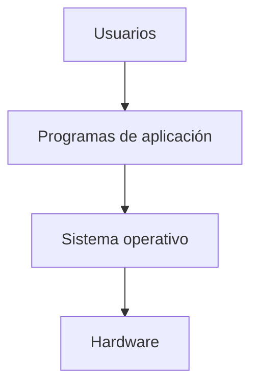
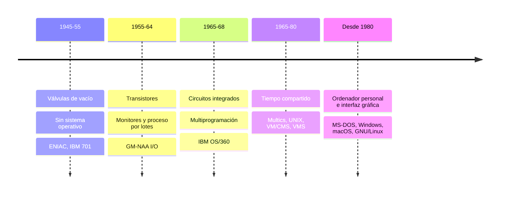

# Introducción

## 1. Definiciones

No existe una definición universal de sistema operativo. Las más habituales son tres.

| Enfoque | Definición | Limitación |
|---|---|---|
| Núcleo | El programa que se ejecuta continuamente (el *kernel*) | En un microkernel, servicios como el sistema de archivos quedarían fuera |
| Comercial | Lo que se vende junto con el equipo | Varía desde 1 MB hasta varios GB. Ejemplo: el caso de Microsoft contra el Departamento de Justicia de EE. UU. (1998) por incluir el navegador |
| Por funciones | Lo que hace dentro del sistema informático | Es la más útil |

Un sistema informático tiene cuatro componentes: hardware, sistema operativo, programas de aplicación y usuarios.

### Funciones

Desde el punto de vista del sistema informático:

- Gestionar los recursos (tiempo de CPU, memoria, almacenamiento, dispositivos de E/S).
- Controlar la ejecución de los programas de usuario y el acceso a la E/S.

Desde el punto de vista del usuario, lo que se percibe es la interfaz (gráfica o de línea de comandos), la organización del almacenamiento y la ejecución de programas. Cambia mucho de un sistema a otro, por eso esta perspectiva es poco precisa.

El sistema operativo no hace un trabajo útil por sí mismo: ofrece el entorno para que lo hagan las aplicaciones.

## 2. Tipos de sistemas

### Mainframe

Se caracterizan por tener mucha memoria, mucho almacenamiento y gran fiabilidad, más que por la potencia de su CPU. Evolucionaron en tres etapas:

- **Por lotes.** Un monitor del sistema carga y ejecuta un conjunto de programas uno tras otro. Mientras un programa hace E/S, la CPU queda sin usar.
- **Multiprogramado.** Hay varios programas en memoria y la CPU pasa a otro cuando uno espera E/S. Ejemplo: IBM OS/360.
- **Tiempo compartido.** Añade terminales y reparte la CPU en ventanas de tiempo (cuanto), de modo que cada usuario cree tener la máquina para él. Ejemplos: UNIX, VMS, OS/400.

Hoy se habla de sistemas multitarea, que reparten la CPU entre todos los trabajos y no solo entre usuarios.

### Según el objetivo de diseño

| Tipo | Prioriza | Ejemplo |
|---|---|---|
| Mainframe | Fiabilidad y uso eficiente del hardware | IBM OS/360 |
| Escritorio | Facilidad de uso y tiempo de respuesta | Windows, macOS, Linux |
| De mano | Facilidad de uso y duración de la batería | Smartphones, tablets |

En todos los casos la función principal es la misma: gestionar recursos y controlar programas.

### Multiprocesador

Varios procesadores comparten bus, reloj y a veces memoria y periféricos. Hoy cualquier CPU con varios núcleos entra en esta categoría.

- **AMP (asimétrico).** Un procesador principal reparte tareas a otros secundarios. Ejemplo: las GPU, o el procesador Cell de la PlayStation 3.
- **SMP (simétrico).** Todos los procesadores son iguales y cada uno ejecuta una copia del núcleo. Es el caso más común.

Ventajas: más trabajo realizado, economía de escala y alta disponibilidad. Un sistema con N CPU no es N veces más rápido, porque la sincronización tiene un coste.

### Distribuidos

Ordenadores independientes conectados por red, que se comunican por mensajes.

- **Cliente-servidor.** Los servidores atienden las peticiones de los clientes. El servidor puede ser un cuello de botella por su ancho de banda.
- **P2P.** Todos los nodos son iguales y actúan como cliente o servidor según el momento. Ejemplos: BitTorrent, Bitcoin.
- **Clúster.** Varios equipos con almacenamiento compartido y un balanceador de carga. Sirven para dar escalabilidad y alta disponibilidad, o para computación de alto rendimiento (HPC).

Respecto al sistema operativo, uno **de red** ofrece acceso a la red pero cada equipo es autónomo; uno **distribuido** hace que el usuario vea una sola máquina (por ejemplo, Amoeba), aunque nunca se popularizó.

### Tiempo real

Se usan cuando hay plazos estrictos de tiempo. Están muy ligados a los sistemas empotrados.

| | Estricto (*hard*) | Flexible (*soft*) |
|---|---|---|
| Plazo | Debe cumplirse siempre | Se cumple casi siempre |
| Ejemplo | ABS de un automóvil | Reproductor de vídeo |
| Memoria virtual | No suele tenerla | Compatible |

Tiempo real no es lo mismo que alto rendimiento: lo importante es cumplir el plazo.

## 3. Historia

- **Primera generación (1945-55).** Válvulas de vacío, programación en lenguaje máquina y sin sistema operativo.
- **Segunda generación (1955-64).** Transistores, lenguajes como ensamblador, FORTRAN y COBOL, y procesamiento por lotes. GM-NAA I/O (1956) se considera el primer sistema operativo.
- **Tercera generación (1965-68).** Circuitos integrados y multiprogramación. IBM OS/360 fue un proyecto de software de escala inédita y sirvió de base a la ingeniería del software.
- **Cuarta generación (1965-80).** Tiempo compartido, terminales y máquinas virtuales.
  - *Multics*: primer sistema con sistema de archivos jerárquico y listas de control de acceso.
  - *UNIX* (1970): herramientas pequeñas combinables y «todo es un archivo». Se escribió en C, lo que facilitó portarlo. Dos familias: System V y BSD. El estándar POSIX apareció en 1988.
  - *VM/CMS*: hipervisor de IBM para crear máquinas virtuales.
  - *VMS*: pionero de la memoria virtual y antecesor en ideas de Windows NT.
- **Quinta generación (desde 1980).** Ordenadores personales e interfaces gráficas.
  - *CP/M* y *MS-DOS*: MS-DOS no tenía multitarea ni modo dual.
  - *Mac OS*: el clásico usaba multitarea cooperativa y no tenía protección de memoria. Mac OS X (2001) se basó en NeXTSTEP (Mach y BSD).
  - *Windows*: de la familia 3.x y 9x, sobre MS-DOS, a la familia NT (1993), que usa un núcleo híbrido y es la base de Windows 11.
  - *GNU/Linux*: el núcleo Linux (1991) junto con las herramientas del proyecto GNU.
