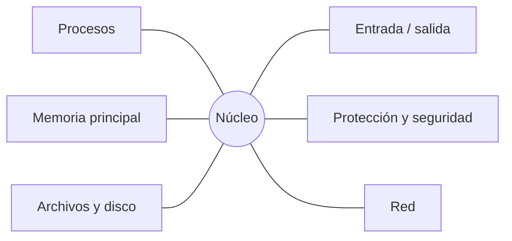
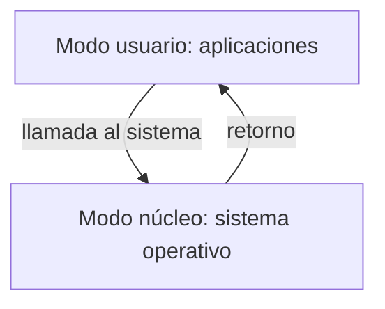

# Organización

## 4. Componentes del sistema

El sistema operativo se divide en módulos, cada uno encargado de un recurso.

- Gestión de procesos
- Gestión de la memoria principal
- Gestión de archivos y del almacenamiento secundario
- Gestión de la entrada/salida
- Protección y seguridad
- Red

## 5. Servicios del sistema

| Para los programas y usuarios | Para el propio sistema |
|---|---|
| Interfaz de usuario | Asignación de recursos |
| Ejecución de programas | Contabilidad de uso |
| Operaciones de E/S | Protección y seguridad |
| Manejo del sistema de archivos | |
| Comunicaciones | |
| Detección de errores | |

## 6. Interfaz de programación

Las aplicaciones piden servicios al sistema a través de una **API**, el conjunto de funciones que el sistema ofrece. Normalmente la API usa **llamadas al sistema**, que pasan a modo núcleo.

Estándares habituales: POSIX en UNIX y Linux, Win32 en Windows. POSIX permite portar programas entre variantes de UNIX.

## 7. Operación del sistema

El sistema está dirigido por interrupciones: el hardware avisa de los eventos y el sistema responde.

Para protegerse, usa dos modos de ejecución:

- Las instrucciones privilegiadas solo se ejecutan en modo núcleo.
- Un temporizador evita que un programa monopolice la CPU.
- Sin modo dual (como en MS-DOS), un error en una aplicación puede afectar a todo el sistema.

## 8. Sistemas por su estructura

| Estructura | Descripción |
|---|---|
| Monolítico | Todo el sistema dentro del núcleo |
| Por capas | Cada nivel usa solo los servicios del inferior |
| Microkernel | Núcleo mínimo; el resto son procesos con menos privilegios. Ejemplo: Mach |
| Híbrido | Combina varios enfoques. Ejemplos: Windows NT y macOS (núcleo XNU) |

El microkernel gana en seguridad y fiabilidad, pero puede perder rendimiento.
