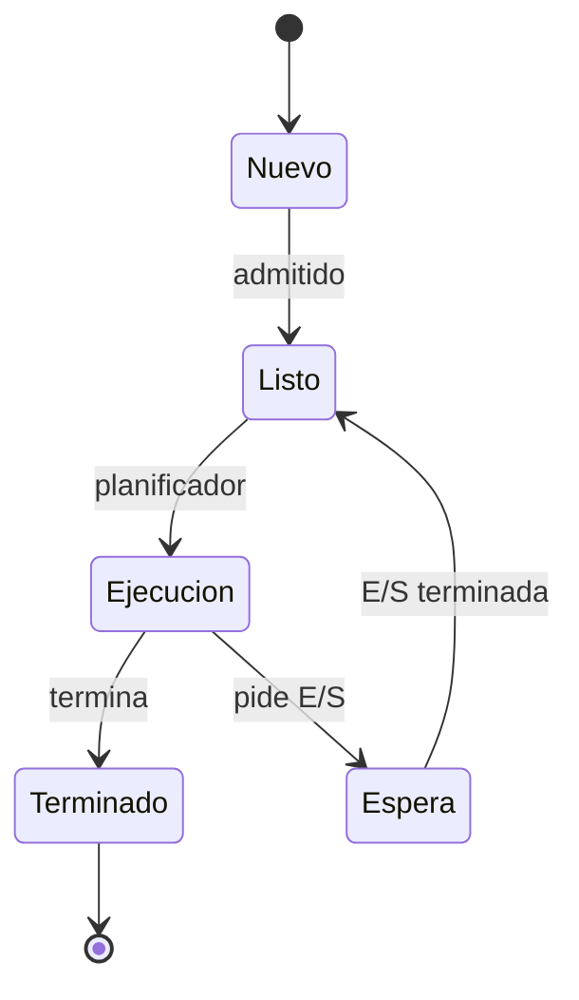

# Gestión de procesos

## 9. Procesos

Un proceso es un programa en ejecución. Pasa por varios estados:

El sistema guarda la información de cada proceso en su **bloque de control (PCB)**. Cuando cambia de un proceso a otro hace un **cambio de contexto**: guarda el estado del que sale y restaura el del que entra.

## 10. Planificación de la CPU

Decide qué proceso listo usa la CPU y durante cuánto tiempo.

Criterios para comparar algoritmos: utilización de CPU, rendimiento, tiempo de espera y tiempo de respuesta.

Algoritmos habituales: FCFS, SJF, por prioridades, Round Robin y colas multinivel.

En **Round Robin** cada proceso recibe la CPU por turnos de un cuanto fijo:

```mermaid
gantt
    title Round Robin
    dateFormat X
    axisFormat %s
    section CPU
    P1 :0, 1
    P2 :1, 2
    P3 :2, 3
    P1 :3, 4
    P2 :4, 5
    P3 :5, 6
```

## 11. Paso de mensajes

Los procesos se comunican sin compartir memoria, mediante `send()` y `receive()`. Los mensajes pasan por el núcleo.

- Comunicación directa (se nombra al proceso) o indirecta (mediante un buzón).
- Envío y recepción bloqueantes o no bloqueantes.

## 12. Memoria compartida

Los procesos acuerdan una región de memoria que ambos pueden leer y escribir.

Es más rápida que el paso de mensajes porque, una vez creada, los accesos no pasan por el núcleo. Los procesos deben coordinarse para no corromper los datos. Ejemplo clásico: el productor y el consumidor.

## 13. Hilos

Un hilo es una unidad de ejecución dentro de un proceso.

| Se comparte | Es propio de cada hilo |
|---|---|
| Código, datos y archivos abiertos | Registros y pila |

Son más ligeros que los procesos y aprovechan los sistemas multinúcleo. Un fallo en un hilo puede afectar a todo el proceso.

## 14. Sincronización

Si dos hilos modifican un dato compartido a la vez, el resultado depende del orden de ejecución (condición de carrera).

| Paso | Hilo 1 | Hilo 2 | contador |
|---|---|---|---|
| 0 | | | 5 |
| 1 | lee 5 | | 5 |
| 2 | | lee 5 | 5 |
| 3 | escribe 6 | | 6 |
| 4 | | escribe 6 | 6 |

Tras dos incrementos debería valer 7, pero vale 6.

La solución es garantizar exclusión mutua en la **sección crítica**, con mutex, semáforos o monitores. Mal usadas, estas herramientas pueden causar interbloqueos.
