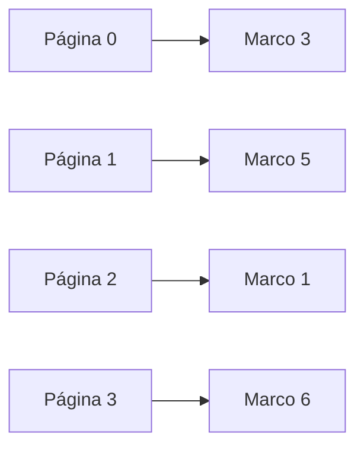

# Gestión de la memoria

## 15. Memoria principal

Hay que repartir la memoria entre varios procesos y protegerlos entre sí.

```text
| SO | Proceso A | libre | Proceso B | libre | Proceso C |
      ^base       ^base+límite
```

Los registros **base** y **límite** acotan el espacio de cada proceso. La MMU traduce las direcciones:

    dirección física = base + dirección lógica   (si es menor que el límite)

Si la dirección supera el límite, el hardware genera un error de protección. Los huecos pequeños y dispersos producen **fragmentación**.

## 16. Paginación

La memoria lógica se divide en **páginas** y la física en **marcos** del mismo tamaño. La **tabla de páginas** indica qué marco ocupa cada página.



- Un proceso no necesita memoria contigua.
- Desaparece la fragmentación externa, pero puede haber fragmentación interna en la última página.
- La TLB es una caché que acelera la traducción.

## 17. Memoria virtual

Permite ejecutar procesos que no están completamente en memoria. Solo algunas páginas están en RAM y el resto permanece en disco hasta que se necesitan (paginación por demanda).


Cuando no hay marcos libres se elige una página para reemplazar (FIFO, LRU...). Si hay demasiados fallos de página, el rendimiento cae: es la **hiperpaginación**. También permite mapear archivos en memoria y acceder a ellos como si fueran memoria.
